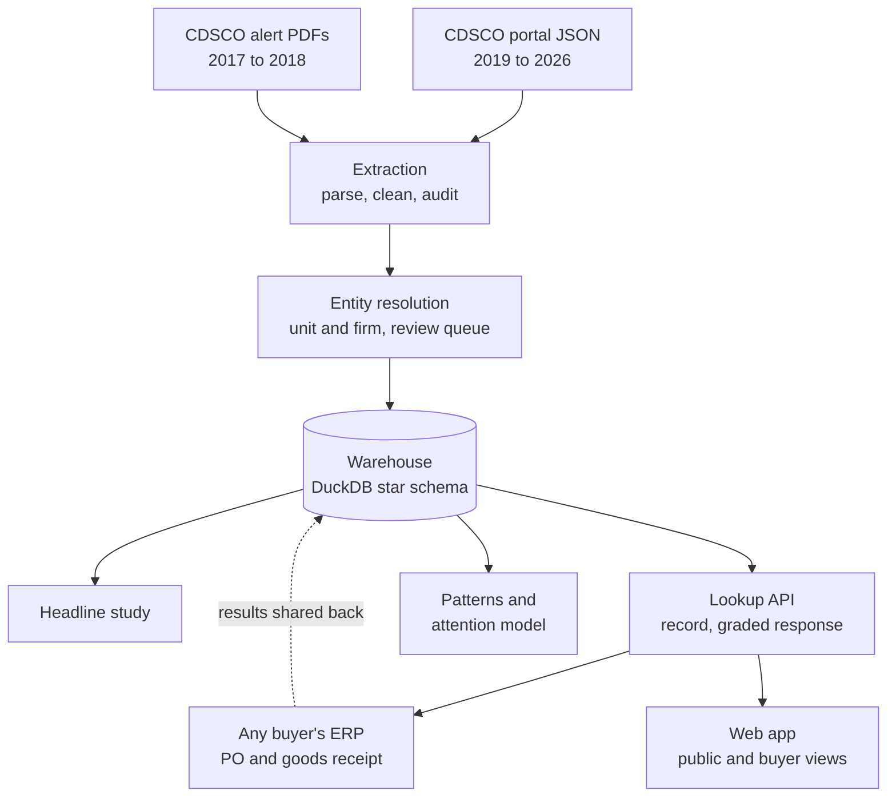
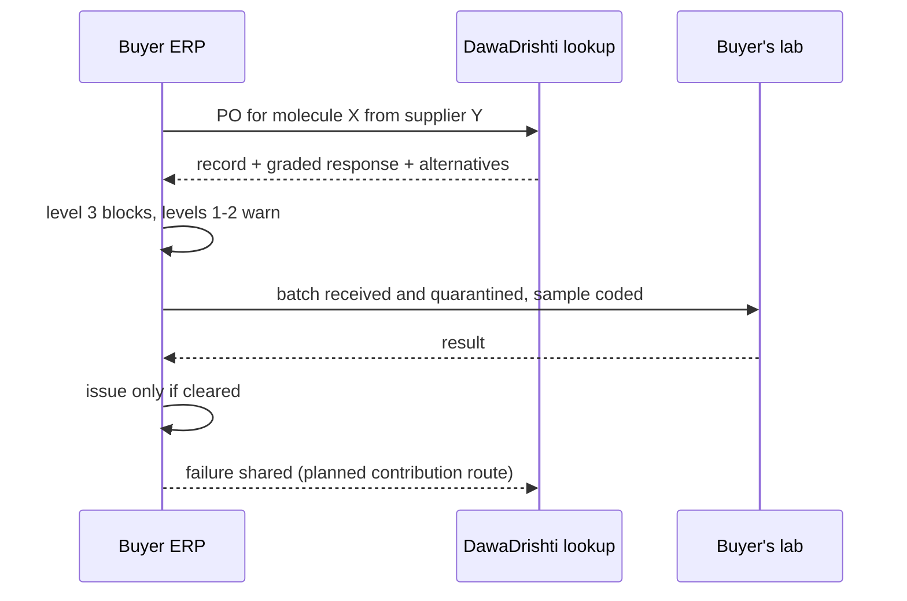

# Architecture

DawaDrishti is **a national quality memory with a lookup API**, not an ERP. Buyers keep their own systems (DVDMS, e-Aushadhi, a state corporation's ERP) and call the lookup at two moments: when raising a purchase order, and when receiving goods. The reference buyer console shows what that looks like inside an ERP, using simulated buyers.

## Components

**Extraction** (`etl/portal.py`, `etl/crawl.py`, `etl/parse_pdf.py`, `etl/stage.py`, `etl/audit.py`)
- Sources: portal JSON for 2019–2026, and PDFs for the earlier months.
- Every cleaned field keeps its raw text.
- The PDF parser is audited against the portal for months where both exist.

**Entity resolution** (`etl/clean.name_key`, `etl/entities.py`, `entity_eval.py`)
- Unit = firm + state; firm = units joined across states.
- Merges at a score of 92 or more are automatic. The 80–92 band goes to a review queue.
- Evaluated on labelled pairs.

**Warehouse** (`warehouse.py`)
- DuckDB star schema with two fact tables:
  - `FACT_NSQ_FINDING`: real alerts;
  - `FACT_BATCH_EVENT`: the simulated buyers' event log.
- Shared dimensions: supplier (unit and firm), product, failure, lab, buyer, activity and date.
- Views `v_findings` and `v_events`.

**Headline study** (`study.py`)
- Measures: repeat share, lead time, detection elsewhere, concentration.
- Uncertainty from a cluster bootstrap; robustness from rerunning under five matching rules.
- Worked cases.

**Lookup API** (`memory.py`, `GET /api/v1/lookup?q=…&view=public|buyer&molecule=…`)
1. Resolves the name. Below the threshold it returns candidates and no record.
2. Returns the published record with `data_as_of`, `data_does_not_contain`, a correction link and `regulatory_action` (null unless cited).
3. The buyer view adds:
   - the graded response (levels 0–3);
   - the future-regulatory-attention score with its held-out AUC;
   - alternatives from the buyer network's supplier masters.

**Reference buyer console** (`erp/schema.py`, `erp/service.py`, `erp/simulate.py`)
- An SQLite OLTP schema, with 20 months of simulated history for 5 fictional buyers.
- Screen 1, the purchase order:
  - the graded response for each supplier on the rate contract, with level 3 blocking unless an override is recorded;
  - beside it, the supply position: concentration and days of cover.
- Screen 2, goods receipt:
  - batches are quarantined and ordered by batch risk;
  - issue is refused until the lab clears the batch (rule R1, enforced rather than only monitored).

**Conformance and process mining** (`mining/conformance.py`, `mining/process.py`)
- Implemented from scratch, without pm4py (which is AGPL).
- Rules are declarative data: precedence, response within N days, and requires.
- Analyses: directly-follows discovery, variants, performance, buyer benchmark, and a root-cause decision tree.
- The same engine reads XES and CSV logs, for the BPI Challenge 2019 validation.

**Patterns and models** (`mining/patterns.py`, `mining/risk.py`)
- Patterns: FP-Growth association rules, k-means archetypes, spike detection, geography.
- Models: gradient boosting for future regulatory attention (real) and batch risk (simulated), each against simple baselines on a time split, with a confound check.

**Questions** (`ai/ask.py`)
- Nine reviewed SQL templates with bound parameters, checked against values in the data.
- A keyword parser chooses the template, or Gemini does when `GEMINI_API_KEY` is set.
- No model writes SQL or prose about a firm.

**API and web** (`api/main.py`, `web/`)
- FastAPI serves the API, with OpenAPI docs at `/docs`, and the React app.
- The app has a public/buyer view switch; predicted scores appear only in the buyer view.

## Data flow at a buyer

The last step, buyers and state labs sending results back, is designed but not built. The Kaysons case shows why it is needed: failures found by a state lab that never reached the national list.
