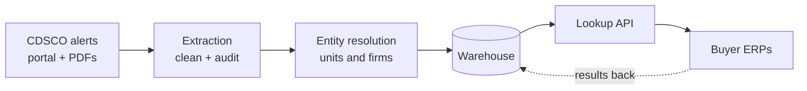

# DawaDrishti (दवा दृष्टि)

**A national memory of medicine-quality failures, with a lookup any public buyer's ERP can call**

Abhishek Jadli ([@AbhishekJadli007](https://github.com/AbhishekJadli007)) · COMMIT FOR GOOD 2026 · Track: AI for Resilient and Sustainable Supply Chains · Revised proposal, 13 October 2026 · Code: [github.com/AbhishekJadli007/dawadrishti](https://github.com/AbhishekJadli007/dawadrishti)

---

## 1. Summary

> **Two in three failed medicine batches in India come from a factory that was already on the national failure list.** In nine years of CDSCO's published alerts, 64.9% of 6,442 failed batches came from a manufacturing unit that already had an alert in an earlier month (95% CI 62.2–67.4%). Half of those repeats were caught by a lab, or in a state, that had never caught that unit before. The record exists. No buyer's ERP reads it.

DawaDrishti turns that public record into a **lookup that any buyer's ERP can call** at two moments: before a purchase order, and at goods receipt.
- **Public view.** It returns only what was published, with an as-of date, what the data does not contain, and a way to request a correction.
- **Buyer view.** It adds a graded response (pause, test every batch, prefer alternatives) and a model score for future regulatory attention.

It is **a public-record aggregator with a risk signal for buyers, not a blacklist, and not a new ERP.**

What is built and measured on real data:
- **The headline study:** the repeat share with a bootstrap confidence interval, robust across five name-matching rules.
- **An audited extraction of the alerts:** the PDF parser agrees with CDSCO's structured portal on 96.7–99.8% of fields.
- **Evaluated entity resolution:** 5,521 name strings become 1,994 units, at precision 1.00 on held-out hard pairs, with a human review queue.
- **The lookup API and a two-screen reference buyer console:** the console uses simulated buyers and is labelled as such.

## 2. The problem

- **Failures are common.** 3,104 drug samples were declared not of standard quality (NSQ) in 2024–25, out of 1.16 lakh tested. CDSCO's labs flagged 211 samples in October 2025 alone.
- **Failures kill.** 24 children's deaths had been reported by 15 October 2025 after they took Coldrif cough syrup, which was contaminated with diethylene glycol ([ETV Bharat](https://www.etvbharat.com/en/bharat/madhya-pradesh-coldrif-cough-syrup-fatality-count-rises-after-many-children-die-enn25101506375)). In 2022, syrups from another Indian manufacturer were linked by WHO to child deaths in The Gambia.
- **Failures recur where buyers cannot see them.** One supplier's samples failed 40 times in Rajasthan's state testing (2021–23). It was banned for a year, then reinstated, and resumed supplying.
- **The pieces exist but are not connected.**
  - CDSCO publishes every failed batch: monthly PDFs, and a public portal since 2019.
  - Buyers run their own systems: DVDMS, e-Aushadhi, and state medical-services corporations.
  - Nothing joins the two. A buyer in one state cannot see that a supplier's batch failed in another.

## 3. The finding: is there anything for a memory to remember?

We resolved every manufacturer in the alerts, ordered each unit's failures in time, and asked: when a batch fails, was its maker already on the national record?

| Measure (real CDSCO alerts, Sep 2017 – Aug 2026) | Result |
|---|---|
| Failed batches whose unit already had an alert in an earlier month | **64.9%** (95% CI 62.2–67.4%) |
| The same, among critical failures (contamination, sterility, adulteration, fakes) | 59.0% |
| Median months from a unit's first failure to its next | 8 |
| Repeats caught by a lab / in a state that had never caught that unit before | 52.6% / 52.8% |
| Share of all failures from the top 10% of units | 47.5% |
| The same repeat share with exact name matching | 4.2%: one factory is spelled up to 14 ways |

**The honest counter-finding.** Sresan (Coldrif) and Maiden (The Gambia) had **no** national alert before their disasters. Kaysons' 40 failures in state testing **never reached** the national list.

A memory built only from CDSCO's list would have missed all three. That is why the design includes a route for state labs and buyers to send their results in.

## 4. What we build, and what we do not

| We build | We do not build |
|---|---|
| A national memory: alerts, resolved to units and firms, in a warehouse | A new ERP for buyers to migrate to |
| A lookup API that existing ERPs call | A blacklist or a "quality rating" of firms |
| A reference buyer console: two screens showing the lookup inside an ERP | Free-text AI answers about named firms |

## 5. How it works

| Component | Method | Evaluated by |
|---|---|---|
| Extraction | Portal JSON (2019–26) and pdfplumber for PDFs (2017–18); rule-based cleaning of name, state, product, failure and severity | PDF vs portal audit on 1,307 matched rows |
| Entity resolution | Normalisation rules, blocking, fuzzy scoring, union-find. Unit = firm + state; firm = units across states | 200 labelled pairs (120 development, 80 held out) |
| Warehouse | DuckDB star schema: failures and buyer events share the supplier, product and date dimensions | Rebuilt from source by one command |
| Headline study | Repeat share, lead time, detection elsewhere, concentration; cluster bootstrap; five matching rules | Confidence interval and the matching-rule sensitivity table |
| Lookup API | Resolves names; returns the record and, in the buyer view, the graded response | Policy tests (no score in the public view; candidates for uncertain names) |
| Conformance engine | Declarative rules plus process discovery, written from scratch (pm4py is AGPL) | Identical counts to hand-written checks; on the real BPI 2019 SAP log (1.6M events) it reproduces the published counts and finds 655 payments before goods receipt |
| Attention model | Gradient boosting on each unit's alert history, time split | AUC vs three baselines; state confound check |
| Questions | Nine reviewed SQL templates with bound, checked parameters | Injection test; the model never writes SQL |

## 6. The graded response

| Level | Response | Rule | Inside the buyer's ERP |
|---|---|---|---|
| 3 | Pause new orders | A critical failure in 12 months, or debarred by a buyer | PO blocked unless an override is recorded |
| 2 | Test every batch | A critical failure 13–36 months ago, or 2+ alerts in 12 months | No skip-lot testing |
| 1 | Prefer alternatives | Any alert in 36 months | At equal price, choose another supplier |
| 0 | No recent record | Nothing in 36 months | Absence of a record, not a certificate |

**The link is the manufacturer; the batch is a bonus.** Alerts carry the manufacturer's batch numbers and no buyer, so a buyer's records match an alert by batch only if it bought that very batch. That is rare, but when it happens goods receipt holds the batch at once. Everything else works at manufacturer level.

**The response comes with its cost.** Beside it the console shows the supply position for the item:
- how concentrated the buyer's supply is (for example, "single source: 91% from one supplier");
- the days of cover.

A pause is only safe if the buyer can see what it does to supply.

## 7. Naming manufacturers

Full policy: [NAMING_POLICY.md](NAMING_POLICY.md).
- **Public pages show records, never predicted scores.** Ranked predictions appear only in the buyer view, and are worded as where to sample, not as findings.
- **Every answer carries its limits:** an as-of date, a list of what the data does not contain, a correction route, and a `regulatory_action` field filled only from cited orders.
- **No guessed identities.** A name that matches below the automatic threshold returns candidates and no record.
- **No misattributed failures.** Fakes are not counted against firms that denied making them, and rows that name a buyer instead of a maker are excluded.
- **No model-written claims.** No language model writes SQL or any sentence about a firm.

## 8. Data and how far it can be trusted

| Check | Result |
|---|---|
| Records | 6,659 failed batches, Jul 2017 – Aug 2026 (6,604 portal NSQ, 48 spurious, 7 from PDFs) |
| PDF parser vs portal | 96.9% row precision; field agreement: product 98.7%, maker 99.1%, state 99.8%, result 98.8%, dates 96.7–97.7% |
| Bugs found by the audit | Split header words (the manufacturing date was missing in 74% of rows, now 2%); letter-spaced text |
| Entity resolution, held-out hard pairs | Precision 1.00, recall 0.63 (v1 rules: 0.48; exact names: 0.00). With human review of the 80–92 band, recall 0.98 |
| State extraction fix | The last place named wins, and marketer addresses are ignored; this moved Sresan from Karnataka to Tamil Nadu |
| Failure taxonomy fix | "Adulterated", "BET" and bare "Content" are now classified; 96.1% of failures classified |

## 9. Evaluation summary

Details: [EVALUATION.md](EVALUATION.md).

| Question | Data | Result |
|---|---|---|
| Do failures come from units already on record? | Real | 64.9% (CI 62.2–67.4%) |
| Can next-6-month alerts be predicted? | Real | AUC 0.774 vs 0.745 for the best simple rule. On the top 50, "most recent failure" wins (84% vs 76%) |
| Is that only state sampling, or a lab re-testing? | Real | No. The model scores AUC 0.758 / 0.756 inside and outside the most-sampled states (state alone: 0.601), and 0.765 when a lab that never caught the unit finds the next failure (330 of 386 units) |
| Does the conformance engine count correctly? | Simulated + real | Identical to hand-written checks on 6,100 simulated cases. On the real BPI 2019 SAP log it matches all 4 published counts and finds 655 payments before goods receipt, and none where SAP enforces the rule |
| Does test-the-riskiest-first help? | Simulated | 69% of failing batches in the first 30% of tests, vs 28% first-in-first-out |
| What would sharing change? | Simulated | Orders to debarred suppliers −81%; failed batches received −30% |

## 10. Scope and status

| Tier | Item | Status |
|---|---|---|
| 1 | Extraction + field-accuracy audit | Done |
| 1 | Entity resolution with evaluation and review queue | Done (labels await human review) |
| 1 | Headline study (cross-state repeat failures) | Done |
| 1 | Lookup API + manufacturer record (as-of dates, data limits, correction route, alternatives) | Done |
| 2 | Conformance engine (declarative), validated on BPI Challenge 2019 | Done |
| 2 | Reference buyer console: PO warned, goods receipt blocked until clearance, concentration, days of cover | Done (simulated buyers) |
| 3 | Future-regulatory-attention model with confound check | Done |
| 3 | Questions as parameterised templates (model picks, never writes SQL) | Done |
| — | API-level enforcement of the naming policy (buyer key), exact-batch hold at goods receipt, reviewer decisions applied by the build | Done |
| Next | Contribution route for state labs and buyers | Designed, not built |

## 11. Timeline and owner

A solo project: every task is owned by Abhishek Jadli.

| Hours | Work | Owner | Status |
|---|---|---|---|
| 0–1 | Problem analysis; check data sources (CDSCO portal, PDFs) | Abhishek | Done |
| 1–3 | Extraction, cleaning, PDF-vs-portal audit | Abhishek | Done |
| 3–5 | Entity resolution: rules, labelled pairs, threshold sweep, review queue | Abhishek | Done |
| 5–6 | Headline study with bootstrap and matching-rule sensitivity | Abhishek | Done |
| 6–8 | Lookup API, graded response, naming policy in the UI | Abhishek | Done |
| 8–9 | Reference buyer console; declarative conformance engine, validated on BPI Challenge 2019 | Abhishek | Done |
| 9–10 | Attention model and confound check; question templates | Abhishek | Done |
| 10–12 | Documentation, deployment (Hugging Face Space), demo video | Abhishek | In progress |
| After | Human review of the labels; contribution route; one-state pilot with a DVDMS export | Abhishek, with a state partner | Planned |

## 12. Deployment and cost

- **Hosting.** Everything runs on free tiers: GitHub (code), and a Hugging Face Space on CPU basic (app and API).
- **Database.** The warehouse is a single DuckDB file. A national refresh (fetch + build) takes about 7 minutes on a laptop.
- **LLM.** The optional LLM step uses Gemini's free tier. Without a key, a keyword parser chooses the question templates, so nothing breaks.

## 13. Risks and limitations

- **Alerts list failures, not tests.** There are no failure rates, so we measure recurrence on the record.
- **Sampling is uneven.** The attention model predicts regulatory attention, not true quality, and is never shown publicly.
- **Labels.** The entity-resolution labels are the assistant's until people review them. Missed merges make the headline conservative.
- **Simulated buyers.** All buyer-side results are simulated, and labelled so wherever they appear.
- **Naming real firms carries legal risk.** It is managed by the policy in section 7: records only, a correction route, and no model-written claims.

## Sources

- CDSCO NSQ alerts: [public NSQ portal](https://cdscoonline.gov.in/CDSCO/Drugs) and [monthly alert PDFs](https://cdsco.gov.in/opencms/opencms/en/Notifications/Alerts/)
- [IndiaMedToday: over 3,000 drug samples declared NSQ in 2024–25](https://indiamedtoday.com/over-3000-drug-samples-declared-not-of-standard-quality-in-2024-25-nadda/)
- [IANS: 211 samples NSQ in October 2025](https://ianslive.in/cdsco-labs-flag-211-drug-samples-as-not-of-standard-quality-in-october--20251121110525)
- [ETV Bharat, 15 October 2025: Coldrif death toll reaches 24](https://www.etvbharat.com/en/bharat/madhya-pradesh-coldrif-cough-syrup-fatality-count-rises-after-many-children-die-enn25101506375)
- [Deccan Herald: Rajasthan halts distribution of Kaysons Pharma drugs, suspends the drug controller](https://www.deccanherald.com/amp/story/india%2Frajasthan%2Fcough-syrup-row-rajasthan-government-suspends-drug-controller-halts-distribution-of-kaysons-pharma-drugs-3752117)
- [Down To Earth: cough syrup deaths in Rajasthan](https://www.downtoearth.org.in/amp/story/health/cough-syrup-deaths-in-rajasthan-families-allege-negligence-while-government-denies-link-to-medicine)
- [The South First: WHO alert, child deaths in The Gambia](https://thesouthfirst.com/health/who-issues-alert-as-syrups-manufactured-by-indian-firm-are-linked-to-deaths-of-66-children-in-gambia)
- [DT Next: CDSCO starts risk-based inspection in 6 states](https://www.dtnext.in/amp/story/news/national/cough-syrup-deaths-cdsco-starts-risk-based-inspection-at-manufacturing-units-in-6-states-848582)
- [MoHFW letter on DVDMS, May 2025](https://qps.nhsrcindia.org/sites/default/files/2025-05/DO-States%20-%20To%20Update%20Nomenclature%20of%20Facilities%20on%20DVDMS%20as%20Per%20IPHS.pdf)
- [JMHIDPCL: flow chart of quality clearance](https://jmhidpcl.jharkhand.gov.in/uploads/Flow-Chart-QC.pdf); [Deccan Herald: drug quarantine policy](https://www.deccanherald.com/amp/story/india%2Fkarnataka%2Fquarantine-likely-for-drugs-until-they-pass-sample-tests-3480932)
- van Dongen, B.F. (2019), BPI Challenge 2019, 4TU.ResearchData, doi:10.4121/uuid:d06aff4b-79f0-45e6-8ec8-e19730c248f1; [ICPM 2019 challenge page](https://icpmconference.org/2019/?p=302)
- [pm4py on PyPI (AGPL-3.0)](https://pypi.org/project/pm4py)
